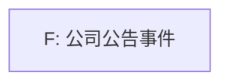

# V1

- 视频 ID：`V1`
- 命题数：1；关系数：0

## 事实传导链

- （暂无可渲染事实关系）

## 作者推理链

- （暂无可渲染作者关系）

## 外部核验

- `V1:C1`：unverifiable（来源等级 S1）

## 断裂边、争议边和替代解释

- （暂无断裂边）

## 来源表

| source_id | publisher | grade | title | URL | access_failure |
| --- | --- | --- | --- | --- | --- |

## Mermaid 关系图

